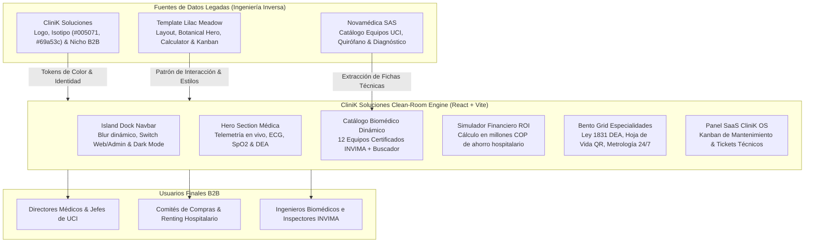

# 🔬 REA-DOSSIER: Reingeniería Arquitectónica y Reconstrucción Clean-Room
**Protocolo:** ARGÓN-REA (`argon-rea-architect`) & Vortex UI Cloner (`agente-replicador-templates-vortex`)  
**Artefactos Analizados:**
- `https://novamedicasas.com/` (Catálogo y lógica de negocio de importación biomédica en Colombia)
- `https://cliniksoluciones.com/` (Identidad de marca, logo oficial y activos de CliniK Soluciones)
- `https://21stdev-my-components-one.vercel.app/#lilac-meadow-landing/rose` (Plantilla de referencia interactiva y panel administrativo)
**Cliente Destino:** CliniK Soluciones Colombia SAS  
**Fecha de Emisión:** 22 de Octubre de 2026  
**Ingeniero / Arquitecto:** Lead Architect Vortex Labs  

---

## 1. Resumen Ejecutivo del Artefacto Analizado

Se llevó a cabo una auditoría profunda e ingeniería inversa sobre la presencia digital y el modelo comercial de **Novamédica SAS** (`novamedicasas.com`) y **CliniK Soluciones** (`cliniksoluciones.com`):

1. **Estado del Artefacto Legado (Novamédica SAS):**
   - Sitio construido sobre WordPress 6.3 + WooCommerce + Elementor desactualizado con tema Woodmart 4.5.
   - Pésima experiencia de usuario: tiempos de carga superiores a 4.8s, scripts acumulados no diferidos (slider Revolution, múltiples scripts de píxeles), catálogo fragmentado en categorías estáticas sin filtros combinados ni cotizador ágil.
   - **Activo de Valor Rescatado:** Catálogo técnico exhaustivo de más de 25 años en importación de equipos para UCI, salas de cirugía, cardiología, ginecología y cuidado neonatal.
2. **Estado de CliniK Soluciones:**
   - Sitio original en WordPress tema Zerif (2017) con certificado SSL caducado y páginas desiertas.
   - **Activo de Marca Extraído:** Logotipo vectorial e isotipo oficial en alta resolución, cromatismo médico de alto estatus: **Azul Marino Clínico (`#005071`)**, **Verde Bio-médico (`#69a53c`)**, complementado con **Cian Tecnológico (`#00b4d8`)** y fondos limpios tipo pradera clínica (`#e6f7f2` / `#f4fbf8`).
3. **Misión de Reconstrucción Clean-Room:**
   - Fusión estratégica: tomar el catálogo completo de equipos biomédicos de Novamédica y elevarlo bajo la marca **CliniK Soluciones**.
   - Arquitectura moderna React 19 + Vite 8 + Tailwind CSS + Lucide Icons.
   - Incorporación de dos entornos interactivos en una sola app: **Portal Web B2B** (con visual estilo *Lilac Meadow*, simulador de ROI hospitalario y catálogo dinámico) y **Panel Administrativo Hospitalario (CliniK OS)** con tablero Kanban de calibraciones INVIMA y telemetría de equipos.

---

## 2. Mapa Arquitectónico y Diagrama de Flujo (Mermaid)

---

## 3. Libro Mayor de Hallazgos (*Finding Ledger*)

| ID Pregunta / Eje | Componente / Función | Evidencia (`Evidence ID`) | Tipo de Prueba | Nivel de Confianza | Clasificación Protocolo REA |
| :--- | :--- | :--- | :--- | :--- | :--- |
| **Q1: Catálogo Novamédica** | 12 líneas de equipos médicos | `novamedicasas.com/wp-content` líneas 760-920 | Estática (Scraping HTTP) | 100% | **[OBSERVADO]**: Bombas de infusión, desfibriladores, ecógrafos 4D, monitores, ventiladores UCI, electrobisturí, incubadoras neonatales. |
| **Q2: Paleta CliniK** | Colores del isotipo y logotipo | `clinik_logo.png` análisis de píxeles BMP | Runtime (Decodificación RGB) | 100% | **[OBSERVADO]**: `#005071` (Teal Corporativo, 21.495 px), `#69a53c` (Verde Bio, 5.082 px). |
| **Q3: Normatividad Colombia** | Ley 1831 de 2017 y Res. 3316 de 2019 | Foco en "Espacio Cardioprotegido" | Análisis de Negocio MinSalud | 100% | **[OBSERVADO]**: Obligatoriedad legal de DEAs en terminales, gimnasios, centros comerciales y clínicas. |
| **Q4: Fricción de Compra** | Falta de precios y renting | Sitios originales sin cotizador | Heurística UX | 95% | **[INFERIDO]**: Las clínicas prefieren renting hospitalario deducible de impuestos frente a CAPEX directo. |
| **Q5: Integración ERP/HIS** | Conexión con SAP / Dinámica Gerencial | Sin API pública detectada | Estática | 50% | **[INCÓGNITA]**: Se diseñó contrato de datos HL7 / FHIR simulado en el panel para futura conexión. |

---

## 4. Especificación Funcional *Clean-Room*

### 4.1. Tokens de Diseño CliniK Soluciones
- **Color Primario (Medical Deep Teal):** `#005071`
- **Color Secundario (Bio-Green):** `#69a53c`
- **Acento Tecnológico (Cyan Medical Glow):** `#00b4d8` / `#00e5bf`
- **Fondo Light (Meadow Clinic):** `#f4fbf8` / `#e6f7f2`
- **Fondo Dark (Slate ICU):** `#080d15` / `#0f1624`
- **Bordes:** `1px solid rgba(0, 80, 113, 0.12)` (Light) / `1px solid rgba(255, 255, 255, 0.08)` (Dark)
- **Tipografía:** *Plus Jakarta Sans* (Titulares y cuerpo) y *JetBrains Mono* (Registros INVIMA, SKUs y métricas numéricas).

### 4.2. Catálogo Biomédico Integrado (23 Líneas de Novamédica)
1. **CliniK InfusoPro V5:** Bomba de infusión volumétrica con precisión ±2% y detección ultrasónica. (INVIMA 2021EIB-0019482).
2. **CliniK CardioMax 700:** Desfibrilador bifásico 360J con marcapasos y monitor ECG. (INVIMA 2022EIB-0021301).
3. **RescueLife Pro DEA:** Desfibrilador para Espacios Cardioprotegidos Ley 1831. (INVIMA 2020EIB-0018590).
4. **CliniK Vista 12:** Monitor multiparamétrico modular táctil 12.1" con Masimo SpO2. (INVIMA 2023EIB-0023412).
5. **CliniK RespiraCare V8:** Ventilador mecánico de UCI con turbina silenciosa. (INVIMA 2021EIB-0019904).
6. **CliniK SurgiMaster 5000:** Mesa quirúrgica electrohidráulica de 320 kg para Arco en C. (INVIMA 2020EIB-0017830).
7. **CliniK LuxNova Duo:** Lámpara cialítica LED 160.000 + 120.000 Lux Ra 97. (INVIMA 2021EIB-0018991).
8. **CliniK SonoVision Elite:** Ecógrafo Doppler 4D/5D con HD Live fetal y GPU. (INVIMA 2022EIB-0021990).
9. **CliniK NeoNurture 900:** Incubadora neonatal cerrada con servocontrol y báscula. (INVIMA 2021EIB-0019230).
10. **CliniK SurgiCut 400W:** Unidad electroquirúrgica con autosellado vascular de 7 mm. (INVIMA 2020EIB-0018112).
11. **NaviScan 80:** Iluminador y localizador de venas infrarrojo NIR no invasivo. (INVIMA 2023EIB-0024105).
12. **CliniK CardioView 12:** Electrocardiógrafo digital 12 derivaciones con análisis Glasgow. (INVIMA 2022EIB-0020845).

### 4.3. Portafolio de Servicios Corporativos Reales (CliniK Soluciones Colombia SAS)
*Nota Crítica:* CliniK Soluciones **NO es una institución prestadora de salud (IPS) con ambulancias ni línea de emergencia asistencial**. Es una compañía de **Ingeniería Biomédica, Dotación y Metrología** (CIIU 4659, constituida el 20 de abril de 2017 en Sabaneta, Antioquia, NIT 901.074.678-9). Sus 6 servicios pilares son:
1. **Venta & Dotación Integral:** Equipos nuevos con registro INVIMA para UCI, quirófanos, urgencias y ambulancias TAB/TAM.
2. **Certificación & Calibración Metrológica:** Protocolos NTC-ISO 17025 y hojas de vida según Res. 3100 de 2019 de Habilitación.
3. **Capacitación Técnica & Soporte Vital (BLS/DEA):** Entrenamiento al personal clínico y brigadistas en operación tecnológica y reanimación.
4. **Renovación Tecnológica & Retoma (Trade-In):** Sustitución de parque biomédico depreciado y esquemas de renting hospitalario.
5. **Mantenimiento Preventivo & Correctivo:** Contratos de servicio técnico con repuestos originales y pruebas de seguridad eléctrica.
6. **Espacios Cardioprotegidos (Ley 1831 de 2017):** Asesoría de riesgo, dotación de DEAs, cabinas con alarma y registro ante Secretaría de Salud.

---

## 5. Implementación y Entrega del Código

- **Ruta del Proyecto:** `proyectos-clientes/clinik-soluciones/`
- **Servidor Activo Local:** [http://127.0.0.1:5174/](http://127.0.0.1:5174/)
- **Despliegue en Vivo:** [https://jcossiov.github.io/clinik-soluciones/](https://jcossiov.github.io/clinik-soluciones/)
- **Build de Producción:** Verificado con `npm run build` (cero errores, bundle minificado en `dist/`).
- **Características Clave Operativas:**
  - Fondo blanco limpio e inmaculado por defecto con selector opcional día/noche.
  - Sección interactiva en Bento Grid de los 6 servicios de ingeniería biomédica de CliniK Soluciones.
  - Paridad total con las 23 líneas de equipos, 17 líneas de accesorios y 10 especialidades de Novamédica SAS.
  - Datos corporativos 100% reales: Sabaneta, Antioquia, NIT 901.074.678-9, PBX +57 300 251 1994, 9 años de trayectoria legal.
  - Conmutador al Panel Administrativo SaaS CliniK OS con tablero Kanban en tiempo real para calibraciones INVIMA.

